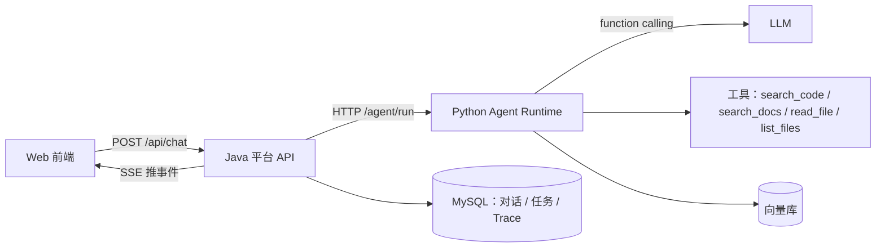

M1 收尾时我把代码从头过了一遍。能编译，接口能通，前端也能拿到回答，但是出现了一个很傻逼的问题。

现在每次调用接口的用时是 20 毫秒，接上 LLM 之后一次 5 到 30 秒，这其实也正常，但是如果你的项目中把LLM的思考回复过程也当作事务去监听那链接数不够用啊。同一个写法，在 20 毫秒的时候看不出毛病，到 30 秒就变成把整个后端拖死。

## 0. 背景

这个项目叫 AgentForge，用途是对着一个 Git 仓库和一堆 Markdown 文档做问答。用户在前端提一个问题，后端把相关代码或文章检索出来，交给模型组织答案，回答里带文件路径和行号，当然这是一小部分功能，本人想要把这个项目做的很大

项目按 M1 到 M4 分期推进，M1 只做最小闭环。



一次提问经过的步骤：

1. 前端把问题 POST 到 Java 平台 API
2. Java 校验会话和项目，把用户消息写进 MySQL
3. Java 建一条 task 记录，状态 `running`
4. Java 通过 HTTP 调 Python 的 `/agent/run`
5. Python 决定走代码检索还是文档检索，调工具，再调模型
6. Python 把结果返回给 Java
7. Java 落助手消息、`task_step`、`trace_span`，把 task 改成 `success`，同时用 SSE 把过程推给前端

Java 这一侧管业务表、权限、任务生命周期和推送，Python 那一侧管 Agent 循环、工具和模型调用。

下面所有代码都是伪代码，只保留和问题有关的那几行。真实实现是 Spring Boot 加 FastAPI，换成别的语言，问题一样成立。

## 1. 一个注解让连接被占 30 秒

M1 里 `chat()` 整个方法被一个事务包住：

```text
function chat(request):
    begin transaction
    save user message
    task = create task(status=running)
    resp = http_post(agent_runtime, request)   # 5~30 秒
    save assistant message
    update task(status=success)
    commit
```

在 Spring Boot 里这是方法上加一个 `@Transactional`，在 Django 里是 `transaction.atomic()` 包住整个函数，在 SQLAlchemy 里是 `begin()` 到 `commit()` 之间塞了一次网络请求。写法不同，问题一样。

事务开始时会从连接池借一个连接，并且关掉自动提交。方法正常返回就 commit，抛异常就 rollback，最后归还连接。所以方法执行多久，连接就被占多久。

接上 LLM 之后，Python 里要跑一到多轮模型调用，一次 5 到 30 秒。这段时间里事务一直开着，连接一直被占着，行锁也一直不放。

连接池是 10 个连接，Tomcat 默认 200 个工作线程。10 个人同时聊天就能把池子占满。第 11 个请求就算只是查项目列表，都得先等 10 秒，然后报 `Unable to acquire JDBC Connection`。

可能你会想：那把连接数从 10 改成 1000 不就行了。

不行。MySQL 8 默认 `max_connections` 是 151，写 1000 先被数据库拒绝。就算数据库也放开，连接在 MySQL 里是一个线程加一块内存，1000 个连接光内存就吃掉 1 GB 左右，线程切换和锁竞争的代价全跟着上来。

一次请求里真正跑 SQL 的时间只有 5 到 10 毫秒，其余时间都在等 LLM。10 个连接、每次持有 30 秒，折算下来是 0.33 请求每秒；把持有时间缩到 5 毫秒，同样 10 个连接能撑到每秒 2000 个请求。加连接只是让更多事务一起空等模型，单次持有时间一点没变。

### 失败现场一起被删了

长事务还有个更隐蔽的代价。

Python 挂了、key 错了、模型名写错了，`http_post` 抛异常，异常从 `chat()` 往外抛，事务执行 rollback。刚才插入的用户消息、创建的 task，全部撤销。

数据库里没有这条用户消息，没有这条 task，更不会有 `status=failed`。打开前端想看现场，什么都没有。用户重试一次，你又多一次看不见的请求。

失败现场比成功数据更值钱，长事务恰好把它一起删了。

还有一层：本地事务回滚不了远程副作用。Python 那边的 LLM 已经调过、token 已经扣了、向量库可能已经写入了数据。你以为原子了，其实只有数据库那一半原子。

### 拆法

把一个大事务拆成两个短事务，中间那段不占连接：

| 阶段 | 做什么 | 事务 |
| :--- | :--- | :--- |
| 1 | 存用户消息、建 task | 短事务，毫秒级提交 |
| 2 | HTTP 调 Python | 无事务 |
| 3 | 存助手消息和 Trace，或写失败 | 短事务 |

具体动作是把事务从 `chat()` 上摘掉。`create_task()`、`complete_task()`、`fail_task()` 各自保留事务，此时外层没有事务，它们会自己开一个并立即提交。

代价是分步提交，`complete_task()` 写库失败会出现「助手消息存了、Trace 没落」。M1 阶段可以接受，写日志加重试就够，真要严格一致得等 M2 用 outbox 表加补偿任务。

## 2. 失败路径压根没写

原来 task 建出来状态是 `running`，然后就去调 Python。成功了改 `success`，失败的时候没有对应代码，所以 task 永远停在 `running`，Trace 里同样查不到这次执行。

补法是在失败分支写一条记录：

```text
function chat(request):
    task = create task(status=running)
    try:
        resp = http_post(agent_runtime, request)
    catch e:
        fail_task(task, trace_id, e.message)   # 独立事务，先把现场写进去
        throw e                                 # 再抛给调用方
    complete_task(task, resp)
```

顺序是先落库再抛。反过来的话，抛出去后面就不执行了。

`fail_task` 自己再包一层 try-catch。记录失败这件事本身也可能失败，比如数据库挂了，这时候至少让原始异常还能抛到前端，别被记录失败的异常盖住。

`fail_task` 里做两件事：把 task 改成 `failed` 并写上 `error_message` 和 `finished_at`；再写一条 `status=failed` 的根 span，前端拿同一个 `trace_id` 就能查到。

只加这一段不够，三个前提得同时成立：

| 前提 | 不满足的后果 |
| :--- | :--- |
| 外层没有事务 | `fail_task` 加入外层事务，跟着回滚，等于白写 |
| `trace_id` 在调 Python 之前生成 | 失败时没有号，写不了 failed span |
| HTTP 客户端有超时 | Python 卡死，`catch` 永远不执行，task 永远 running |

## 3. traceId 得由调用方先发

原来的 `trace_id` 是 Python 在循环最后生成的：

```text
function run_react(request):
    ...
    return {answer: answer, trace_id: random_id()}
```

成功时没问题。失败时 Python 没有返回值，Java 手上没有号，想写一条失败记录都不知道往哪写，前端也查不到任何 Trace。

改成调用方先发号，再随请求传过去：

```text
trace_id = random_id()

function chat(request):
    task = create task(status=running)
    try:
        resp = http_post(agent_runtime, {request..., trace_id: trace_id})
    catch e:
        fail_task(task, trace_id, e.message)
        throw e
    complete_task(task, resp)   # resp 里回传同一个 trace_id
```

Python 收到后原样使用，没收到就自己生成，兼容旧调用。

为什么不直接拿 `task_id` 当 traceId：M1 里一个 task 只对应一次执行，用 `task-601` 也能跑。但 task 是业务任务，trace 是调用链，以后一个 task 重试多次会有多条 trace。多生成一个字符串的成本几乎为零。

## 4. 没有超时的 HTTP 客户端等于没有 catch

大多数 HTTP 客户端默认不设超时，含义是无限等。Python 那边卡住，Java 就一直挂着，等不到成功也等不到失败，`catch` 里的失败落库代码根本没机会跑。

```text
client = http_client()
client.connect_timeout = 5s      # 连不上就放弃
client.read_timeout = 180s       # 等结果最多 3 分钟
```

Spring 的 `RestClient` 要显式设 `connectTimeout` 和 `readTimeout`，Python 的 `httpx` 要显式设 `timeout`。不写就是默认值，而默认值通常比你想的长。

三个超时是独立的：数据库连接超时、事务超时、HTTP 超时。可能出现 Python 第 28 秒成功返回，但 Java 的连接在第 25 秒已经被回收，两边不一致。拆掉长事务之后，这种竞争窗口基本消失。

## 5. 工具参数是模型填的

`read_file` 最早的实现：

```text
function read_file(file_path, root):
    path = file_path
    if not is_absolute(path):
        path = join(root, path)
    return read(path)
```

`file_path` 是绝对路径的时候，它直接跳过 root，读任何文件。

以前的调用链是固定的：`search_code` 返回相对路径，`read_file` 读这个路径，模型碰不到 `file_path`。接上 function calling 之后，`file_path` 是模型生成的参数，而模型会被用户的话影响。用户只要说一句「帮我读一下 /Users/xxx/.ssh/id_rsa」，模型可能就照做。

模型不是安全边界。

改法是把路径展开成真实路径之后再判断它在不在根目录里：

```text
function read_file(file_path, root):
    resolved = realpath(join(root, file_path))

    if not inside(resolved, root):
        reject "路径越界：只能读取项目目录内的文件"

    if sensitive(resolved):
        reject "禁止读取敏感文件"

    if not is_file(resolved):
        reject "文件不存在"

    return read_lines(resolved, start, end, max=200)
```

`realpath` 会把 `..` 和软链接一起展开，所以 `../../etc/passwd` 和指向仓库外的链接都会被拦下。

只加这一条还不够。`.env` 就在仓库根目录里，里面有 LLM key、MySQL 密码、对象存储密码，所以还要拦敏感文件名：

```text
SENSITIVE_NAMES = [".env", ".env.local", ".env.production", "id_rsa", "id_ed25519"]
SENSITIVE_SUFFIXES = [".pem", ".key", ".p12", ".jks"]

function sensitive(path):
    return path.name in SENSITIVE_NAMES
        or path.suffix in SENSITIVE_SUFFIXES
        or any(part in [".git", ".ssh"] for part in path.parts)
```

读到的内容会进模型上下文、进消息表、进 Trace 的输出字段。一次提示词注入，密钥就永久留在数据库和日志里了。

还有一半在工具 schema。`repo_url` 和 `blog_path` 不能暴露给模型。如果 schema 里有 `repo_url`，模型可以传 `/Users/xxx`，然后 `search_code` 就去搜整个家目录。

正确做法是在注册表里绑死，服务端注入的字段覆盖模型传的同名参数：

```text
TOOLS = {
    "search_code": {
        "func": search_code,
        "bind": {"root": "project.repo_path"},   # 模型传什么都会被覆盖
        "parameters": {
            "query":       {"type": "string"},
            "max_results": {"type": "integer"},
        },
    },
}
```

模型只能填 `query`、`file_path`、`start_line` 这类业务参数，根目录永远由服务端决定。再补一个行数上限，防止 `end_line=999999` 把整个大文件塞进上下文。

## 6. JDK 23 之后 Lombok 要显式声明

这条最容易误判。

`@Data` 生成的那些 getter/setter 不是运行时产生的，是 Lombok 作为注解处理器在编译期补进 `.class` 的。

JDK 23 起，`javac` 默认不再执行 classpath 上发现的注解处理器。`mvn -v` 显示 JDK 26，`pom.xml` 里只加了 Lombok 依赖，没说「把它当注解处理器跑」。

结果一编译就是几百行「找不到符号 getName()」，看起来像代码写错了，其实是 Lombok 没跑。

为什么之前没暴露，两个原因都会骗人：IDE 用的是 JDK 21，终端和 IDE 不是一套；`target/classes` 里有旧 class，Maven 认为没变化就跳过编译，一改源码就原形毕露。

任何一个 Maven 项目，在 `pom.xml` 里显式声明就行：

```xml
<plugin>
    <groupId>org.apache.maven.plugins</groupId>
    <artifactId>maven-compiler-plugin</artifactId>
    <configuration>
        <annotationProcessorPaths>
            <path>
                <groupId>org.projectlombok</groupId>
                <artifactId>lombok</artifactId>
                <version>${lombok.version}</version>
            </path>
        </annotationProcessorPaths>
    </configuration>
</plugin>
```

`${lombok.version}` 由 Spring Boot 父 POM 管理。加了之后 JDK 26 也能编译，而且只跑你声明的处理器。

## 7. 两个像「代码写错了」的编译错误

### 找不到 `traceId()`

```text
class Request:
    repo_url: string
    # 没有 trace_id 字段

Request.builder().trace_id("x")   # 编译不过
```

报错信息是「无法解析 AgentRunRequestBuilder 中的方法 traceId」。

原因不是 Lombok 坏了，是类里还没有 `traceId` 字段。`@Builder` 按字段生成方法，有字段才有同名链式方法，没有字段就没有。如果 Lombok 真没生效，`.taskId()` 会一起报错。

### 变量作用域

```text
function chat():
    start = now()
    try:
        resp = http_post(...)
    catch e:
        latency = now() - start      # 只在这个 catch 块里存在
        fail_task(..., latency)
        throw e

    save_latency(latency)            # 找不到 latency
```

局部变量只在它所在的那对花括号里有效。`start` 放在 try 前面，成功和失败两条路径都能用；`latency` 要在 catch 后面重新算一次。

## 8. 被「跑通」掩盖的其他几处

### 假流式

Java 等 Python 全部跑完，再把结果拆成几个 SSE 事件推给前端。`stream` 恒为 `false`，Python 也没有逐行输出。

前端看到的是「一次卡住，然后所有步骤同时出现」，不是逐步出现的时间线。这个要等 Python 改成生成器逐条 yield、Java 边读边转 SSE 才算真流式。

### 引用开关传了没人读

`show_citations` 从 Java 一路传到 Python，但循环里没有任何地方读它，永远返回 citations。

参数通了不等于功能通了。这类「链路打通」的假象比没写更麻烦，因为验收时会以为这项已经完成。

### Trace 是空壳

`duration_ms` 写死 0，span 没有父子关系，token 一直是 0。

表建了、数据也写进去了，但写进去的是没有信息量的数据。Trace 的价值在于能还原一次执行发生了什么，`duration_ms=0` 的 Trace 还原不了任何东西。

### 前端校验不是后端校验

```text
# 这个只比较两个数字，没有查项目表
if conversation.project_id != request.project_id:
    reject "会话不属于该项目"

# 这个才去查项目是否存在
project = find_project(request.project_id)
if project is null:
    reject "项目不存在"
```

两段看起来在检查同一件事，其实不是。

前端的正常路径确实只会展示真实存在的项目，但数据会变、页面会过期、URL 能被改、接口能被 curl 直接调用。后端不能假设调用方一定是个正常前端。

### 工程卫生

- README 还写着「阶段 2、agent-runtime 与 web 未创建」，和实际差了两个阶段
- 迁移脚本里重复 `CREATE TABLE message`，加了 `IF NOT EXISTS` 无害，但会误导后来的人
- 提交信息写「M1 除模型全都实现」，实际 ingest、eval、RAG 都没有
- 测试目录是空的，一个测试都没有

## 9. 检查清单

| 检查项 | 现在 |
| :--- | :--- |
| 事务里有没有 HTTP 或 LLM 调用 | 拆掉 |
| 失败路径有没有落库 | `fail_task()` |
| `trace_id` 谁生成 | 调用方先发 |
| HTTP 客户端有没有超时 | 连接 5 秒、读取 180 秒 |
| 工具参数哪些由模型填 | 业务参数可以，根目录不行 |
| 文件读取有没有边界和敏感名单 | `realpath` 加敏感后缀 |
| 构建环境是不是 JDK 23+ | 显式声明注解处理器 |
| 参数通了是不是功能通了 | 逐项验证，别拿链路通当验收 |

后面接 LLM 的工具调用循环时，这几处要先修好。不修的话，出了问题分不清是事务、失败落库还是模型的锅。
