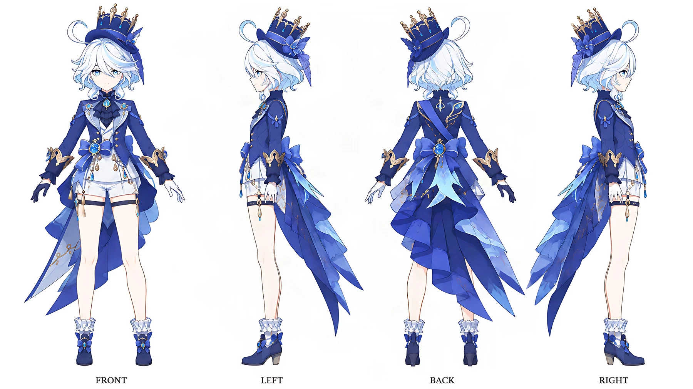
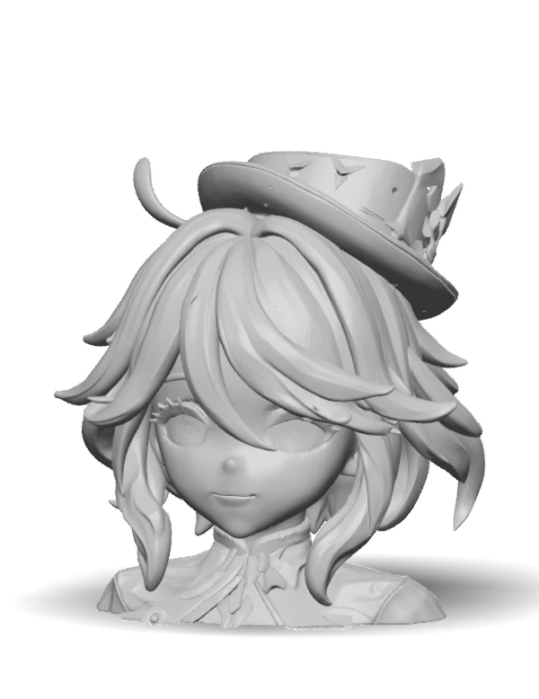
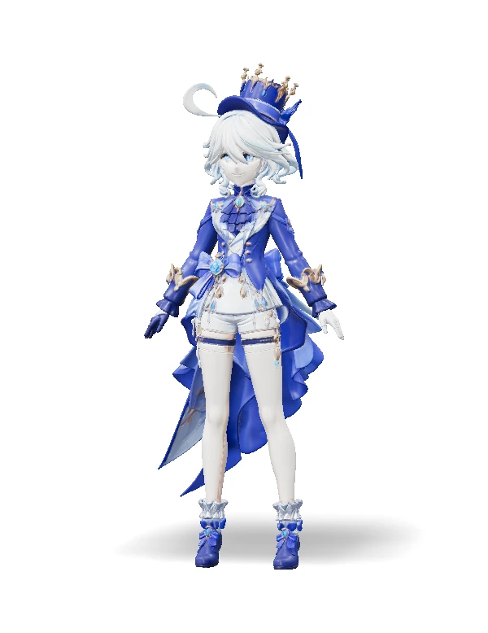
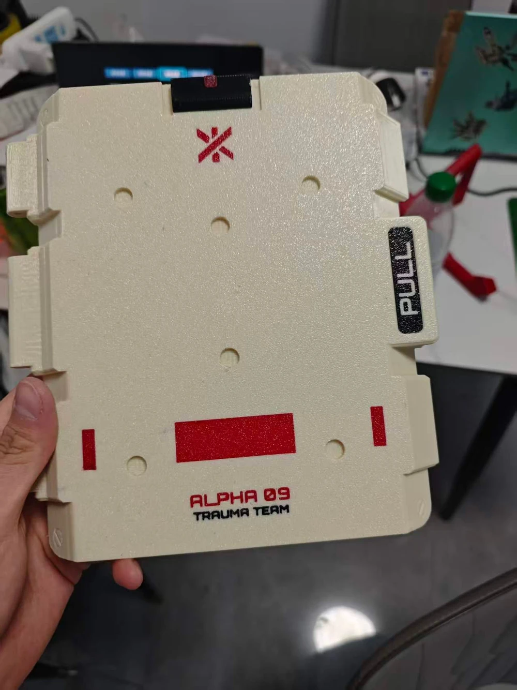

接触 3D 打印有一段时间了，最近想试着接单，但还没正式接。第一台机器打结构件、摆件够用；真要做定制，多色绕不过去，所以开始看第二台机器。

接单的流程先跑顺了：需求进来，先用 GPT 出多视图，丢给 Tripo 生成模型，再进 Blender、SketchUp 或者 MOI 做二次加工，最后切片打印。

每一步都有损耗，但至少知道损耗在哪。真正让我犹豫的是第二台打印机：多色的需求开始出现，手上的机器打多色费劲，可看了一圈，没有一台让我想立刻下单。

## 多视图

只给 Tripo 一张图，它也能出模型，但背面的结构只能靠猜。正面像，侧面和背面经常是另一回事。

所以现在先让 GPT 把需求画成一组多视图：正面、左侧、背面、右侧，白底，正交，几个角度的比例对齐，旁边标好配色和材质。图不用画得多精细，够 Tripo 认准四个方向就行。

GPT 出多视图也会漂。同一件东西，四个角度的细节经常对不上，手指、挂件、纹理这种小地方尤其明显。我的做法是一次多出几张，挑一致性最好的一组；挑不出来就退回提示词，把特征写死再出。

:::tip 多视图描述
同一个角色或物体的正面、左侧、背面、右侧，四个平视角度，白底，正交投影，比例一致，首图用正面，平涂上色，标出主要配色和材质，不要背景和阴影。
:::

这一步花不了多少时间，但能省掉后面反复重做。

## Tripo 那一步

多视图丢进 Tripo，选多视图生成，几分钟就能拿到模型。形状上基本对得上，比例也还过得去，省掉了从零建模的大部分工作量。

问题在网格。Tripo 出来的是三角面，单位还不一定是毫米；曲面和硬边混在一起，薄的地方厚度不够，底面也不一定平。它自带重拓扑、网格分割、补全这些后处理，能用，但还不能直接切片。

导出的时候按后面的软件选格式。Blender 能接 OBJ、GLB 和 STL，要直接打就导 STL，模型本身带颜色还可以导 3MF，把颜色一起带出去。

## 精度测试

这段时间一直在试 Tripo 的精度上限，想知道它能不能直接出能打印的模型。这次拿《原神》里的芙宁娜测了一组，输入是全身四视图，正面、左侧、背面、右侧，白底，比例对齐。先跑头像，再跑全身。

*图：喂给 Tripo 的全身四视图。*

第一次生成的白模是这样的：脸和发丝糊在一起，帽子也软，效果很差。

*图：第一次生成的白模，脸和发丝糊在一起。*

调教之后重新生成，效果好了不少。

*图：调教之后重新生成的半身像。*

调教的过程不展开，这里只看结果。放大看细节，发丝还是粘成一片一片，帽檐上的小齿和金属饰件糊在一起，眼睛、蕾丝、衣领这些地方变成浅浅的浮雕。贴图能把颜色补回来，补不回结构。

全身也跑了一遍。

*图：全身像的结果，比例和大轮廓可以，细节还是靠贴图。*

高精度生成这件事，Tripo 能做出“看起来像高模”的结果，但还不能直接拆件、打印、上色。白模动辄上百万面，直接切片不现实，先减面；减完面，发丝和饰件又会掉一截。这也是我后面还要进 Blender 和 MOI 的原因。

## 三个工具

二次加工这一步，三个工具各管一段。

| 工具 | 擅长的部分 | 不顺手的地方 | 我用它做什么 |
| :--- | :--- | :--- | :--- |
| Blender | 网格修复、重拓扑、雕刻、有机造型 | 精确尺寸和布尔运算要反复调 | 修 Tripo 的烂面，做造型件 |
| SketchUp | 快速搭体块、看空间关系、尺寸直观 | 实体检查和打印准备不是它的强项 | 建筑、场景、简单结构 |
| MOI | NURBS 建模、布尔、倒角、导网格 | 没有参数化历史，造型自由度不如 Blender | 配合件、分件、要上色的硬表面 |

真要做接单，会发现客户要的是“像”，打印要的是“能装、能受力、拆得开”。AI 模型在前一件事上已经够用，后一件事还得靠人。多色打印对建模的要求更高：颜色区域要在建模阶段就分好，不同颜色的件要么拆开打，要么在同一个件上把分面做干净，不然切片的时候换色换得一塌糊涂。

所以我打算学 MOI。它做布尔和倒角干净，NURBS 的尺寸是准的，配合位、卡扣、插接这些地方不容易差；导出网格的质量也够打印。MOI 的正式版还是 4，卖 295 美元，Windows 和 Mac 都能用，官网自己就写着适合 3D 打印。

## 两台机器

第二台机器，多色打印这边，我主要看了创想的两台。

i7 是今年年初发布的 SPARKX i7，单喷嘴加 CFS Lite 四色，换色的时候要靠冲刷把旧料排掉。有评测打一个 31.59 克的件，默认参数下冲出来 489 克废料，是零件本身重量的十五倍。

官方宣传的“省一半废料”在独立测试里没对上，固件从一月到九月更新了三次。喷头速度标到 500mm/s，可换色次数一多，时间还是耗在冲刷上。AMS、CFS 这类单喷嘴多色方案也一样，只是冲刷量不同。以后报价，料钱和时间都得算进去。

i8 是十月下旬才开始预售的 SPARKX i8，走的是另一条路。单喷嘴四通道，四根料各自一条通道通到喷嘴口，换色的时候下一根直接顶上去，官方说 1 秒内完成。

冲刷料可以埋进模型内部的填充里，官方称在支持的场景下外部废料能压到 0 克。成型体积 260×260×255mm，官方定价 2509 元，双十一期间券后 2199 元，海外众筹也过了 463 万美元。

官方给的 1 秒换色、零外部废料，这两点摆在一起，i8 很难不让人心动。

## 网上的评价

i8 的首批评测不多，能看的就几家。

| 好评 | 担心 |
| :--- | :--- |
| 3DPrintscape 首测全部打成功，没看到明显串色 | 换色 1847 次的猫头鹰仍外抛 31.9 克废料 |
| 2199 元，四色一体，官方说换色 1 秒 | 0.4mm 单喷嘴，TPU 受限，细长件可能还得开擦料塔 |
| AM易道拆机：结构没有硬伤，单色四色都稳 | 单电机加凸轮，长期磨损、卡料、堵头要时间证明 |
| 朋友天皇的打印件颜色干净 | 首批报告少；i7 早期批次有换主板、热端、热床的抱怨 |

朋友天皇买了 i8，打的第一个东西是这个盒子。

*图：朋友天皇的 i8 打印件，颜色分区和贴字都挺干净，层纹还在。*

颜色分区、红黑贴字都干净，层纹是 FDM 的正常水平，至少说明装配没翻车。但一台机器打得好，不能代表一批机器的品控。

## 我担心的事

外抛废料还是小事，真正让我犹豫的是维修。i8 把四路选料全压在一套凸轮机构上，靠一个电机转角度来压料，切刀一次剪四根。结构很巧，但磨损、卡料、堵头这些问题，都要靠成千上万次换色来验证。拆机评测的结论也差不多，普通用户值得买，农场主得先做十天以上的长周期测试。

以后接单，机器停一天，单子就得往后拖。第一批机器的品控、固件、售后会怎么样，现在没人说得准。i8 的众筹成绩说明它受欢迎，说明不了它耐用。

作为第二台，i8 现在还不合适。便利是真的，维修风险也是真的，首批品控没数据。现在下单，等于替创想测首批。

所以我没有下单。

## 先学 MOI

真接到多色的单，先拆件打，颜色靠后处理补。等 i8 的固件稳一点、口碑多一点，或者等下一批机器，再决定买不买。

这段时间先把 MOI 学起来。拿手上几个练手件重做一遍，练布尔、倒角、曲面衔接，看看同样一个件，用 MOI 做出来的分件是不是更干净，配合位是不是更准。学得慢也没关系，机器一直在出新的，等得起。
